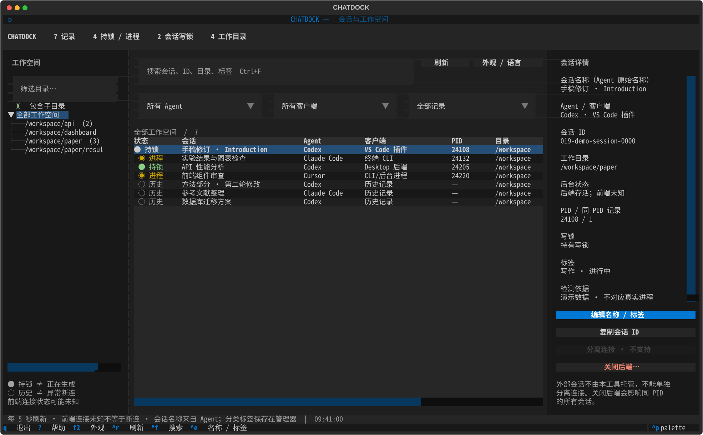
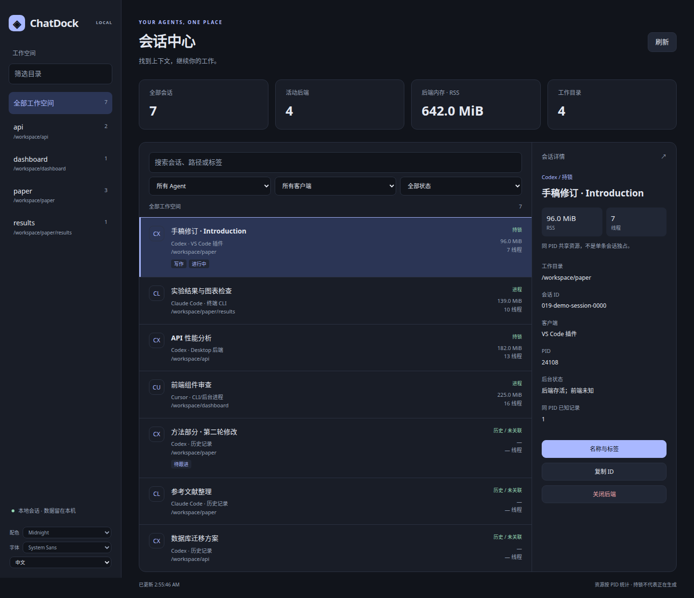

# ChatDock · chatdock

通过终端或本地网页查看不同工作目录、Agent 和客户端的会话。支持鼠标、键盘、目录筛选、名称与标签，以及明确展示影响范围的后端关闭操作。



界面布局参考 [superfile](https://github.com/yorukot/superfile) 的分栏边框与焦点高亮，以及 [herdr](https://github.com/herdrdev/herdr) 的统一工作空间体验，使用 Python + [Textual](https://textual.textualize.io/) 独立实现。ChatDock 检查已有 Agent，不托管或替代它们的终端。

## 快速开始

需要 Linux、Python 3.10+ 和 util-linux 的 `lslocks`。

```bash
git clone https://github.com/PuppetZhou/chatdock.git
cd chatdock
python3 -m venv .venv
.venv/bin/pip install -e '.[tui]'
./chatdock --install-command
chatdock --tui                 # 终端界面
chatdock --web                 # 本地网页版
```

如果安装提示 `~/.local/bin` 不在 PATH 中，将 `export PATH="$HOME/.local/bin:$PATH"` 加入 `~/.bashrc`（Zsh 用 `~/.zshrc`），并在当前终端执行一次。Fish 使用 `fish_add_path ~/.local/bin`。安装命令不会覆盖已有文件或自动修改 Shell 配置。

仓库启动脚本自动使用仓库内的 `.venv`。安装包后，也可以在已激活的虚拟环境中运行 `chatdock --tui`。

查看命令帮助与使用示例：

```bash
chatdock --help               # 简短帮助
chatdock --help-all           # 包括语言、主题、端口等完整参数
```

界面底部显示常用快捷键，按 `?` 或 `F1` 查看完整说明；按 `q` 退出（输入框中先按 `Esc` 返回列表）。

已有命令仍然可用，无需 Textual：

```bash
./chatdock             # 原来的只读文字摘要（Codex）
./chatdock --all       # 包括历史会话
./chatdock --json      # JSON 输出
./chatdock --watch 2   # 每两秒刷新
./chatdock --home /path/to/codex-home
```

默认 Codex 数据目录为 `$CODEX_HOME`，未设置时为 `~/.codex`。

在 SSH 或 VS Code 集成终端内直接运行，不需要端口转发。建议终端至少 **120 列 × 35 行**；表格支持触控板横向滚动、Shift+滚轮，以及表格获得焦点时的左右方向键；也可直接用鼠标拖动表格底部或右侧的滚动条查看客户端、目录等字段，无需箭头按钮。部分终端不会转发触控板横向手势，此时请拖动滚动条。自动刷新会保留滚动位置。小于 85 列时改为上下布局并隐藏目录侧栏，仍可用搜索框搜索路径。鼠标功能依赖终端支持，Tab 和方向键可完成相同操作。

## 本地网页版

```bash
chatdock --web                # 默认 8765 端口
chatdock --web --port 8787     # 自选端口
```

打开终端打印的完整链接（包含 `#token=...`）。服务仅绑定 `127.0.0.1`，每次启动使用新的访问令牌；不要公开分享启动链接。网页可以按工作目录、Agent、客户端和状态筛选，查看完整路径、进程内存和线程数，编辑原生名称与标签，并确认关闭后端。支持中英文、四套配色和字体选择。设置保存在浏览器本地。



**远程服务器 / SSH：** localhost 指运行 ChatDock 的那台机器。在自己电脑上建立端口转发，再打开启动链接：

```bash
ssh -N -L 8765:127.0.0.1:8765 user@server
```

VS Code Remote SSH 也可以在“端口”面板转发 **8765 → 8765**。浏览器端与服务端使用相同端口，以便验证请求来源。不需要开放服务器公网端口。按 Ctrl+C 结束 HTTP 服务，不会停止 Agent。

### 字体

- **终端版**的字体由宿主终端控制，ChatDock 无法单独改变。请在 VS Code 的终端字体设置，或所用终端的字体偏好中选择字体和字号；远程 SSH 使用的是你电脑上的字体。
- **网页版**左下角可选 System Sans、System Mono、JetBrains Mono、Cascadia Code。后两种需要预先安装在浏览器所在电脑上，未安装时回退系统等宽字体。页面不下载外部字体。

### 内存与线程

TUI 和网页版显示 `/proc/<pid>/status` 中的 **RSS 常驻内存**与 **操作系统线程数**。只统计关联 PID 本身，不包含子进程；多个会话共用 PID 时显示相同数据，不能当作单条会话独占资源。网页总内存按 PID 去重，汇总可采样的值。历史会话、无法关联的进程或采样失败显示 `—`，不猜测为零。线程数也不是 Agent 任务数或模型 token 数。

终端目录列按路径长度扩展，可横向滚动；选中目录后上方显示完整路径，右侧详情中的长路径自动换行。

## 语言与主题

按 **F2** 或点击顶部 **外观 / 语言**（English: Appearance）打开设置。选择主题时即时预览；点击应用保存，取消恢复原配色。偏好保存在管理器数据库，下次启动自动恢复。切换语言不会翻译你的会话名称、路径或标签。

```bash
chatdock --tui --lang en                       # 英文界面
chatdock --tui --lang zh                       # 中文界面
chatdock --tui --theme tokyo-night              # 指定主题
chatdock --tui --lang en --theme catppuccin
chatdock --lang en --help                      # 英文命令帮助
```

命令行参数只覆盖本次启动；需要记住选择时，在 F2 设置中点击应用。

| 主题参数 | 配色 | 风格 |
| --- | --- | --- |
| `vscode` | VS Code Dark Modern | 默认；中性灰底、蓝色强调 |
| `tokyo-night` | Tokyo Night | 深蓝紫底、柔和蓝色 |
| `catppuccin` | Catppuccin Mocha | 深灰紫底、粉彩色 |
| `dracula` | Dracula | 紫灰底、明亮紫色 |
| `nord` | Nord | 冷灰蓝底、冰蓝色 |
| `github-light` | GitHub Light | 浅色；白底、蓝色强调 |

这些是按经典色板为 ChatDock 调整的配色，不是官方主题移植。无需安装 VS Code、Starship 或 Nerd Font。参见 [主题预览与参考来源](docs/themes.md)。支持真彩色的终端显示效果最佳；尊重 `NO_COLOR` 设置，若终端主动禁色，主题不会显示彩色。

## 界面操作

| 区域 / 操作 | 功能 |
| --- | --- |
| 左侧工作空间 | 点击完整目录筛选；支持目录搜索、包含子目录；点击根节点回到全部 |
| 顶部筛选 | Agent、客户端、持锁/进程或历史记录 |
| 搜索 | 会话原始名称、分类标签、会话 ID、目录；兼容搜索旧版别名 |
| 中间列表 | 状态、名称、Agent、客户端、目录、PID、标签；鼠标选中或方向键移动 |
| 右侧详情 | 完整 ID、路径、后台状态、同 PID 记录数、检测依据 |
| 编辑名称 / 标签 | Codex 原生会话重命名，分类标签本地保存；其他 Agent 名称暂时只读 |
| 复制会话 ID | 使用终端 OSC 52；终端可能不支持或禁用剪贴板访问 |
| 关闭后端 | 展示同 PID 已知会话；输入 PID 后才发送 SIGTERM |
| Ctrl+F / Ctrl+R | 搜索 / 手动刷新 |
| Ctrl+E / Escape | 编辑名称与标签 / 取消弹窗 |
| q / Ctrl+Q | 退出管理器，Agent 继续运行；输入框中的 q 是普通字符 |
| ? / F1 | 打开界面内帮助；帮助页按 q / Esc 返回 |
| F2 | 外观与语言设置，主题即时预览 |
| Esc | 输入框返回会话列表，或取消弹窗 |

默认每五秒检查后台变化；顶部“自动刷新”可暂停，点击“刷新”或按 Ctrl+R 立即检查。底部显示采样时间与新增（+）、移除（−）、更新（Δ）记录数。变化计数比较名称、目录、PID、客户端、状态和锁，不将内存波动视作对话变化。已有行就地更新，保留选择、筛选和滚动位置；拖动滚动条、编辑或确认弹窗打开时暂缓刷新。

## Agent 支持范围

| Agent | 会话数据 | 活动关联 |
| --- | --- | --- |
| Codex | 本地数据库全部会话、标题与目录 | 系统写锁映射到 PID；识别 VS Code / Cursor 插件、Desktop、CLI、独立服务及代理 |
| Claude Code | `~/.claude/projects/*/*.jsonl` 历史记录 | 另列识别到的 CLI 进程；不猜测会话与 PID 对应关系 |
| Cursor Agent、Gemini CLI、OpenCode | 当前用户可识别的运行进程 | 进程级展示，尚未接入各自历史数据库 |

Claude 有限读取开头元数据及末尾的自定义命名事件，优先显示读取到的最新名称；没有名称或摘要时以 ID 生成标题。当前没有接入 Claude 原生重命名接口，名称只读。后台进程也会显示，即使没有关联会话。

## 状态含义与操作边界

- **持有写锁**表示占有会话写入权，不代表模型正在生成。
- **无写锁 / 历史**不代表异常断连。前端是否在线、任务是否等待输入不能只凭进程判断。
- **前端未知**表示后台存活但无法确认窗口或远程桌面连接状态。
- **独立 app-server**不会因为父进程是 PID 1 就被判为异常。
- **分离连接**暂不支持：外部终端不由本工具托管，没有通用安全的单会话 detach 接口。界面不显示不可用的分离按钮。退出管理器自身不会终止 Agent。
- **关闭后端**作用于整个 PID，可能影响多个会话及未识别任务。操作前重新采样已知会话，检测进程启动时间；发送信号使用 Linux pidfd，避免 PID 复用。确认超过 60 秒或影响列表变化会拒绝操作；当前管理器及其祖先进程也不可关闭。
- SIGTERM 是正常终止请求，不保证目标立即退出；界面通过后续刷新展示状态。工具不发送 SIGKILL，不删除会话、锁文件或项目文件。

多个会话可以共用同一后端，所以不能把关闭进程描述成只断开一个聊天。进程列表和锁信息是不同时间采样，关闭确认之后新加入的任务也可能受影响。

## 数据和隐私

会话名称优先读取 Agent 原始命名（Codex 的 `name` 字段，未命名时回退到 `title`）。列表与详情显示同一个名称，不再以本地别名覆盖。

Codex 重命名调用官方 app-server 的 `thread/name/set`，并通过 `thread/read` 验证结果。需要 PATH 中有支持该接口的 `codex` CLI。工具不直接写 Agent SQLite 数据库、不恢复会话、不启动模型回合。原 APP 如果没有即时更新，请重新打开会话或刷新列表；不保证向所有已打开的客户端推送界面更新。

分类标签及旧版别名保存在：

```text
${XDG_DATA_HOME:-~/.local/share}/codex-status/labels.sqlite
```

**名称和标签不同**：会话名称修改会保存到 Codex；分类标签只在管理器内使用。旧版别名仅在详情中作为“未同步”备注展示，不会自动批量写入 Agent。

默认终端模式不启动网络服务；`--web` 显式启动仅本机可访问的 HTTP 服务，包含访问令牌、Host / Origin 校验和操作确认。管理器不发送模型请求、不消耗推理 token。依赖安装需要网络；重命名启动的官方 Codex 后端可能按照自身配置进行初始化联网。

不要把 Agent 数据目录、认证文件、真实诊断输出或上述管理数据库提交到 GitHub。仓库预览只使用虚构数据。

## 开发与测试

```bash
.venv/bin/pip install -e '.[tui,test]'
.venv/bin/pytest -q
.venv/bin/python docs/render_preview.py
```

测试包含目录边界、标签持久化、鼠标操作、筛选、空结果、确认取消、PID 变化及共享后端影响范围。终止测试仅作用于测试创建的临时子进程。

```text
agentdeck/web.py        本地 HTTP API，复用采集和操作保护
agentdeck/static/       网页界面，无需 Node 构建
agentdeck/terminal.py   终端横向滚轮兼容
agentdeck/install.py    全局命令安装
agentdeck/core.py       原始 Codex CLI 与只读采样
agentdeck/registry.py   Agent 数据整合、筛选、进程操作保护
agentdeck/store.py      本地分类标签与旧版别名 SQLite 存储
agentdeck/naming.py     Codex 原生名称读写（官方 app-server 协议）
agentdeck/tui.py        Textual 界面与交互
agentdeck/deck.tcss     界面样式
agentdeck/appearance.py 六套经典色板
agentdeck/i18n.py       界面中英文文案
```

本工具依赖 Linux `/proc`、系统锁及各 Agent 的内部文件格式；后续版本格式变化可能需要调整适配器。

项目原名为 codex-status / Agent Deck。旧命令 `codex-status` 仍兼容；标签数据库保留原目录，避免丢失已有名称和标签。

原生命名接口参考：[Codex App Server](https://learn.chatgpt.com/docs/app-server)。

当前品牌名为 **ChatDock**，命令为 `chatdock`。`chat-monitor` 和 `codex-status` 保留为兼容入口。
