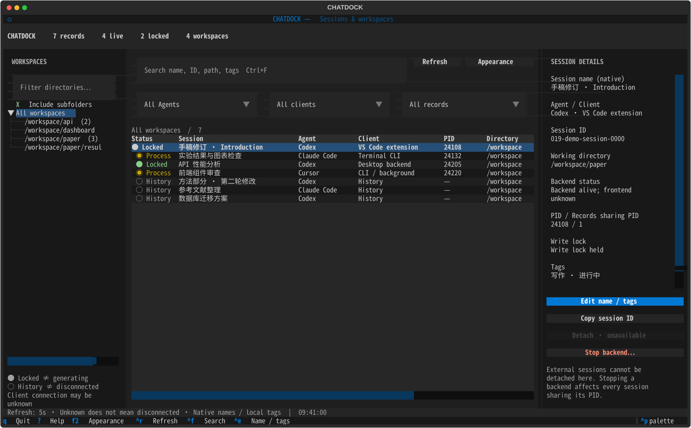
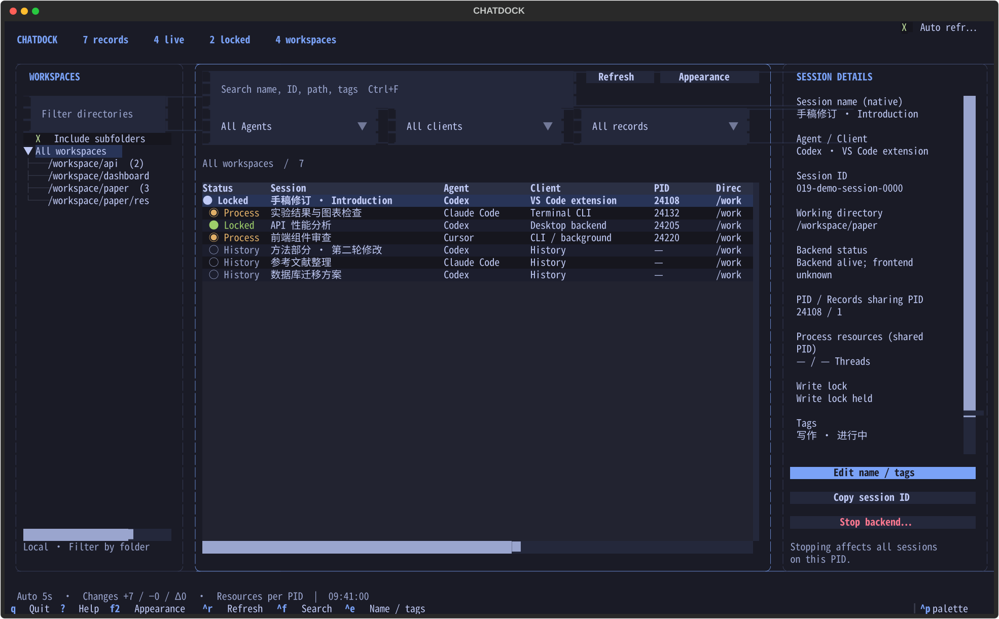
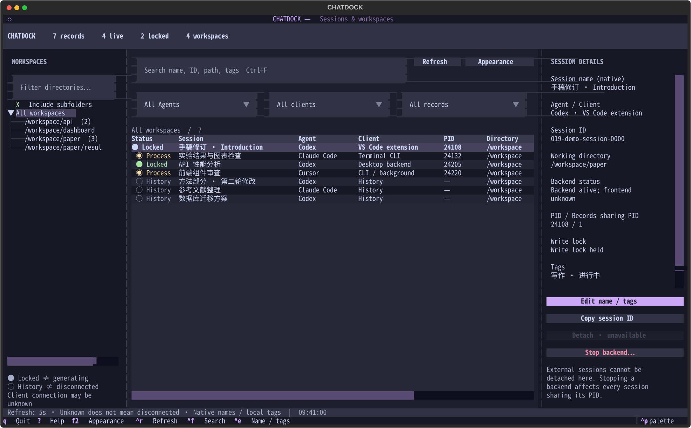
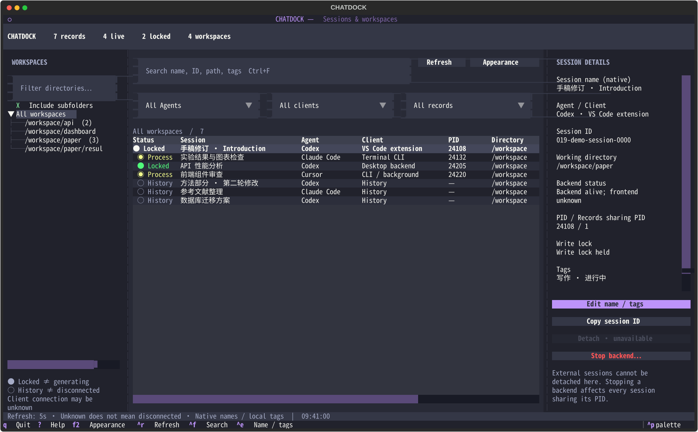
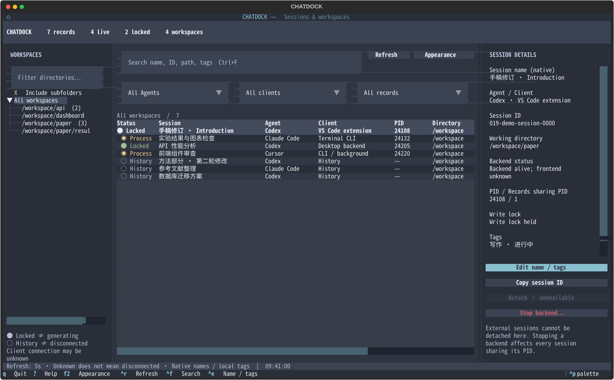
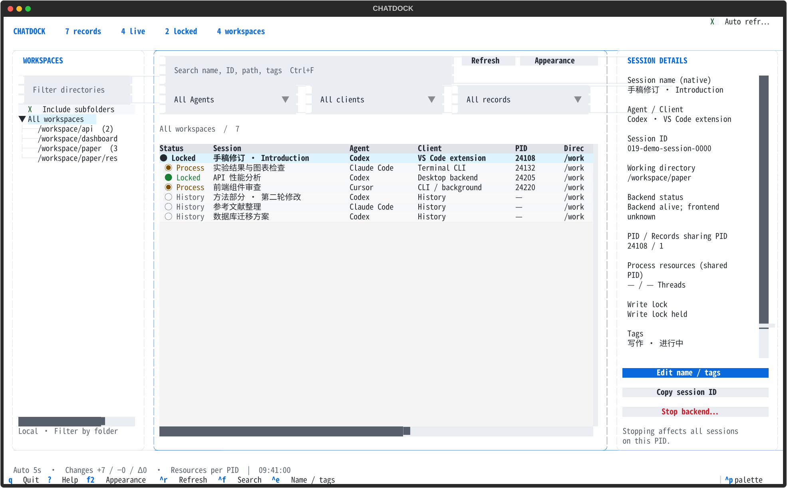

# 主题预览

截图均为虚构演示数据。按 F2 切换主题与语言；取消预览可恢复原配色。

## VS Code Dark Modern

`chatdock --tui --lang en --theme vscode`

## Tokyo Night

`chatdock --tui --lang en --theme tokyo-night`

## Catppuccin Mocha

`chatdock --tui --lang en --theme catppuccin`

## Dracula

`chatdock --tui --lang en --theme dracula`

## Nord

`chatdock --tui --lang en --theme nord`

## GitHub Light

`chatdock --tui --lang en --theme github-light`

## 配色参考

- [VS Code themes](https://code.visualstudio.com/docs/configure/themes)
- [Starship Tokyo Night preset](https://starship.rs/presets/tokyo-night)
- [Catppuccin palette](https://github.com/catppuccin/catppuccin)
- [Dracula palette](https://draculatheme.com/contribute)
- [Nord colors](https://www.nordtheme.com/docs/colors-and-palettes/)
- [GitHub VS Code theme](https://github.com/primer/github-vscode-theme)

ChatDock 使用经典色板做语义化调整，强调色用于焦点与操作，绿/黄/红用于状态；并非上述项目的官方发行版本。
